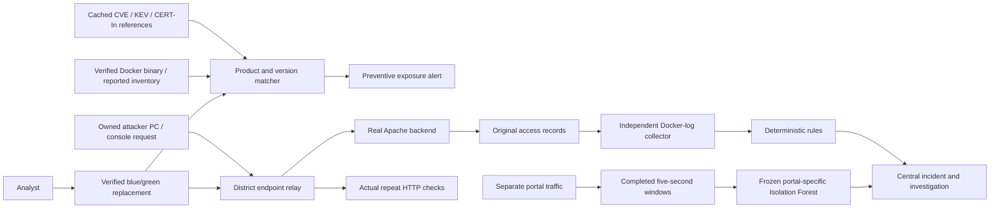

# Live demonstration: an Indian district citizen service

This is an owned, fictional Indian district-service organisation using dummy records. Its
Apache service is a real container, its requests and access logs are real, and its replacement
changes the running endpoint. The original 40 inventory assets remain synthetic. Initialising
all three lab assets brings this setup to 43; they are not 43 live organisations or computers.

## Start on the defender PC

Docker Desktop must be running. From the repository root:

```powershell
.\scripts\start.ps1 -SkipBuild -Background -LiveLab
.\scripts\start-apache-lab.ps1
.\scripts\start-apache-collector.ps1
```

If the registered Vectra server is running without the lab flag, first stop it with
`scripts/stop.ps1 -Port 8000`. The script will not silently replace an unrelated listener.

Open **http://127.0.0.1:8000/lab**. Main incidents/assets remain at `/app`.

- Port 8000: local control/API; never expose this control plane for the two-PC test.
- Port 8011: the district service, whose backend can actually be replaced.
- Port 8012: the fixed-version comparison service.
- Optional port 8010: the separate custom portal for authentication and lab-specific ML.

For two PCs, explicitly use the defender's assigned private IPv4 address:

```powershell
.\scripts\start-apache-lab.ps1 -BindAddress 192.168.1.20
```

Replace the example address. Permit the lab port on the private network if Windows requests it;
no firewall changes are automated. The controller discovers its own Docker binding rather than
accepting arbitrary external target URLs. The physical two-PC setup still needs rehearsal.

## The five-minute story

| Step | Live action | Evidence / statement |
|---|---|---|
| 1. Organisation | Show the district-service asset and owner | Fictional Indian citizen service; service criticality and real installed binary snapshot |
| 2. Preventive warning | Discover owned targets before sending the attack | Docker image identity and `httpd -v` → product/version matching → affected CVE-2021-41773 → CERT-In reference |
| 3. Ordinary request | Send the public notice request | HTTP 200 and actual independently collected record; no traversal finding |
| 4. Attack | Send the dummy-record traversal from the second PC or console | Actual 200 with dummy marker on 2.4.49; original request ID/status/version in logs; correlated incident |
| 5. Investigate | Open its incident/evidence | CVE applicability, rule, source references, original request and limits; template works offline |
| 6. Replace | Apply fixed Apache backend in console | Actual Nginx reload routes the SAME district endpoint to verified 2.4.51; exposure reassessed |
| 7. Verify | Repeat the SAME traversal, plus the notice request | Traversal 404, no dummy marker; public notice 200; action becomes verified |
| 8. Behaviour/ML | Show the separately frozen portal baseline and a new burst | Window features, model ID, rule-versus-ML result and baseline holdout flags |

If already patched from rehearsal, use **Restore vulnerable lab backend**, then verify it
before starting a new owned run. This is an explicit test action, not an attack on a company.
The console's attack button sends an actual bounded HTTP request; it does not insert findings.
The attacker can independently send the same request with Windows curl:

```powershell
curl.exe --path-as-is 'http://192.168.1.20:8011/documents/notice.txt'
curl.exe --path-as-is 'http://192.168.1.20:8011/documents/.%2e/internal/dummy-records.txt'
```

Use the address of your own lab defender. `--path-as-is` avoids the client normalising away
the test path. After replacement, repeat these exact commands; keep the service URL unchanged.
Only dummy documents are needed. No shell, arbitrary host-file extraction or real records are
part of this demonstration. CGI/executable handlers are not loaded.

## What “prediction” honestly means here

The exposure warning can exist **before an attack is sent**: known advisory + installed affected
software + service context → a preventive warning. That is the proactive known-threat path.
Isolation Forest subsequently identifies unusual observed behaviour against its own baseline.

Neither estimates a validated future attack time, attacker identity or compromise probability.
Do not call the unusualness percentile “attack confidence”. Any measured advance-warning time
in this controlled sequence depends on when the operator sends the request, not forecast skill.
A future forecasting claim needs a defined outcome/horizon, labels, an untouched future test
portion and baseline comparison. The UI explicitly states this limit.

## Real lab-specific ML preparation

Start the custom portal in a separate terminal:

```powershell
.\scripts\start-lab-portal.ps1
.\.venv\Scripts\python.exe -X utf8 scripts/train_lab_baseline.py
```

The second command takes roughly three minutes. It sends actual varied notice/missing-notice
requests, freezes a model, then sends a measured burst. It does not insert feature vectors or
choose a prewritten finding. Alternatively, use baseline controls and generate your own traffic.

The forest uses complete five-second active windows with two seconds' finalisation grace;
the control worker checks each second. It needs at least 30 eligible windows and variation.
Earlier 80% trains; later 20% is a chronological operator-baseline holdout. Known rule-positive
and restricted windows are excluded. After freeze, future traffic does not retrain the model.
Historical SecRepo and live Apache logs are separate sensors and are not mixed into this model.

Actual local preparation produced 25 training windows and 7 later holdout windows; 1 holdout
window was flagged. A later 40-request missing-notice burst was flagged without a request-rule
finding. These are small controlled observations, not a production accuracy estimate. Keep the
holdout flags visible. A later request may legitimately get a different result; report it honestly.

## Architecture and provenance



CERT-In reference: [CIAD-2021-0039](https://www.cert-in.org.in/s2cMainServlet?VLCODE=CIAD-2021-0039&pageid=PUBVLNOTES02).
Vendor reference: [Apache CVE-2021-41773](https://httpd.apache.org/security/vulnerabilities_24.html#CVE-2021-41773).
Reviewed metadata in `lab/apache/advisory_sources.json` is not a new/full live advisory scrape.
Apache 2.4.51 is fixed for this historical traversal comparison, not a current production
recommendation; other vulnerabilities in these historical versions can still be relevant.

Image digests, actual binary versions, config hashes, source timestamps and request IDs are
preserved. The relay generates/overwrites its request ID and source headers; the response ID
joins to the independently collected access record. Docker/proxy NAT can obscure the original
source: Apache peer, relay-observed peer and attacker identity are different concepts.

Replacement is real blue/green routing, not an OS package installer. The vulnerable backend
stays isolated for rollback. Successful service verification is not proof of fleet-wide
eradication or the absence of other vulnerabilities.

## Repeat verification and stop

```powershell
.\.venv\Scripts\python.exe -X utf8 scripts/rehearse_apache_lab.py
.\scripts\stop.ps1 -Worker apache-collector
docker compose -f lab/apache/compose.yaml down
.\scripts\stop.ps1 -Port 8000
```

The rehearsal leaves the district endpoint fixed, preserves incidents, and saves
`logs/apache-live-rehearsal.json`. Collector checkpoints/raw captures, runtime config, process
records and logs are ignored. Stop helpers verify process identity. The same configured SQLite
DB is shared by the local app/portal; no secrets or databases belong in Git.

See [LIVE_LAB.md](LIVE_LAB.md) for the custom auth/response details and
[API.md](API.md) for endpoint contracts. Browser presentation and two-physical-PC validation
remain separate from the completed loopback HTTP verification.
