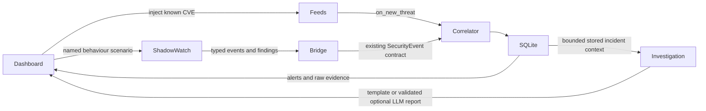

# Integrated frontend and backend

**Historical checkpoint:** this page records the initial integration on 31 October 2026.
Later commits added real-log ML, broader grounded narratives, Attack Lab and campaigns, and
changed cloud opt-in behaviour. Use [STATUS_REPORT.md](STATUS_REPORT.md) and the current README
for the present checkout. In particular, demo mode alone no longer disables an explicitly opted-in LLM.

Run `scripts/start.ps1` from the root, then open http://127.0.0.1:8000/app. The existing Vectra
design is preserved. FastAPI serves the built SPA, its assets, API and history URLs from one
origin. Unknown `/api/*`, hidden files and missing static files return errors rather than HTML.
For editing React use Vite on port 5173, with its proxy targeting `127.0.0.1:8000`.

## Data flow

`DatabaseFindingSink` maps typed events to the existing shared fields and preserves the original
envelope plus findings in `security_events.data` JSON. It uses Member 3's `CorrelationEngine` with
a five-minute window. No independent score formula or new DB/table is added. Marked typed events
use actual Shadow Watch results instead of being reclassified by broader legacy heuristics.
Approved process relationships and benign windows therefore stay benign. Maintenance context
does not suppress independent process/network danger signals.

Each central alert links to stored event IDs. `StoredIncidentProvider` reconstructs the typed
evidence/findings from those records. Legacy shared events are also cited, without manufacturing
missing ingestion times (`retrieved_at: null`). The report caps evidence at 100 items and discloses
truncation. It does not change central scores or infer exploitation from vulnerability exposure.

The normal API lifespan installs the sink and demo incident-provider factory. Explicitly supplied
adapters take precedence. Standalone module replay still uses its bounded preview adapter and
reports `pending_member3`, since it does not start the central app/database.

## Frontend contract changes

| Area | Integration |
|---|---|
| Command Center | Maps backend overview names explicitly; counts come from DB, trend from publication dates; cache availability never implies source health |
| Demo actions | Correct `fixture_id` and named scenarios; actual `alert_ids`; benign result never promises an alert |
| Threats | Backend pagination/search/source/severity/relevance; references and STIX export |
| Incident detail | Fetches the detail endpoint directly, not a partial threat/alert list; exposes three scores, stored sensor events, lifecycle and report actions |
| Report display | Uses real `limitations`, `generated_by`, `integration_status`, evidence IDs and analyst-review requirement |
| Early warnings | Signal history, 24h type counts, configured thresholds and synthetic signal creation |
| Exposure & impact | Sector posture, read-only patch modelling, lead-time cohort/limits, CERT-In and India-related intelligence |
| Offline/error state | Bundled samples labelled on each page; failed mutations stay errors; stale data marked; cloud disabled in demo |

Overview now includes a `trend` array of `{date,count}` for the last 14 days by original publication
date. `matched_assets` and `open_alerts` are real active-alert counts. Threat listing accepts
`relevant=true`. `GET /api/alerts/{id}/evidence` returns up to 100 stored events and a truncation flag.
The demo alert reset also resets its in-memory scenario cache. APIs retain shared field names.

## Boundaries

Public feed facts are cached real-source records. All inventory and behaviour scenarios are
synthetic. The default incident-tool scope permits persisted synthetic incidents only in demo
mode. Real-incident investigation/evidence access requires a replacement authenticated factory.
The local start script binds loopback and disables scheduler/cloud LLM, regardless of `.env`.
No scanning, shell execution, malware execution, patch application or firewall mutation occurs.

## Verification

`backend/tests/test_full_integration.py` verifies the real app lifespan, all three behavioural
scenarios, durable evidence, replay/restart deduplication, reset/replay, acknowledgement, legacy
event citations, verified CVE exposure, patch non-mutation, filtered feed queries, signal
correlation, same-origin SPA routes and access denial outside demo mode.

Frontend verification uses TypeScript and Vite production build. The browser host/native UI
automation pipe was unavailable in this session, so visual/browser interaction QA could not be
completed. The app can be checked directly at the local URL. Existing raw feed reconstruction
checks still require ignored raw payloads not present in this checkout.

Recorded integration run: **216 backend tests passed, 9 failed**. The nine failures were the
existing missing-raw-file checks (eight source reconstructions and the raw provenance hash
assertion). All eight new full integration tests passed. Shared fixture validation returned
zero errors/warnings. TypeScript/Vite production build passed, with the existing landing-page
bundle-size warning.

The actual loopback HTTP check passed all six SPA routes, two entry assets, persisted suspicious
and missing-telemetry cases, benign retention, CVE injection, signal creation/history, sector
posture, patch what-if (2 affected assets before, 0 after), lead-time/India insights and STIX export.
Evidence: [artifacts/integration_http.json](../artifacts/integration_http.json). Reproduce against
the running demo with `.venv/Scripts/python.exe -X utf8 scripts/check_integrated_http.py`.
It adds predefined synthetic cases without resetting existing data and refreshes API samples.

The landing-page score lab now uses configuration exported from the central scoring engine,
with the updated weights and priority thresholds. It is labelled illustrative; real dashboard
scores always come from the backend. `start.ps1` refreshes that configuration before building.
