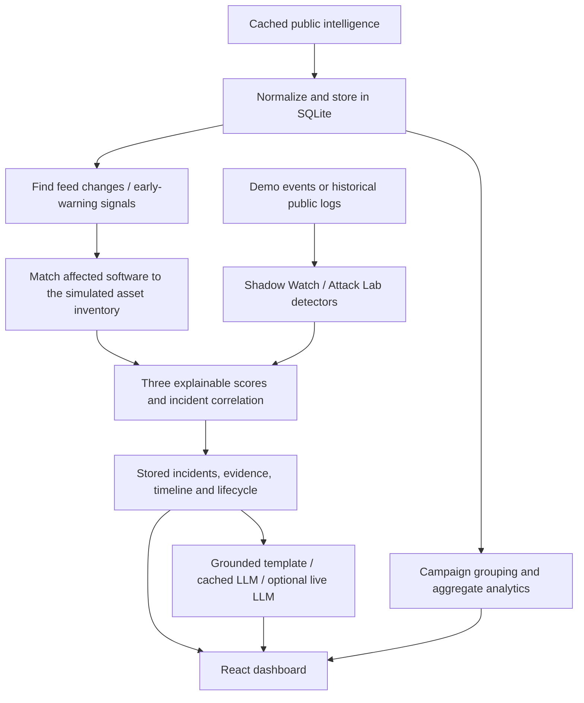

# Vectra repository status and explanation

Review date: **1 November 2026**, Asia/Kolkata. Initial audit at **3c3f590**;
latest follow-up incorporates **d8ee68e** on branch **codex/live-india-foundation**.
This report includes the later campaign, real-log, AI and live-lab work.
It supersedes the original standalone/integration checkpoint for current feature status.

## Latest live foundation follow-up

The latest extension now includes a genuine owned Apache CVE target and live portal-specific ML:

- Official digest-pinned Apache 2.4.49/2.4.51, isolated targets/read-only dummy files and a local
  relay. Registration verifies Docker identity and actual binary version. Independent collection
  imports original request lines, status, source/relay information and generated request IDs.
- Actual same-endpoint backend replacement with fixed Apache, exposure reassessment and later
  independent HTTP verification. Rehearsal: affected → actual dummy disclosure/200 → collected
  finding → verified 2.4.51 replacement → same traversal 404, public notice 200 → unaffected for
  CVE-2021-41773. The investigation cited that CVE. CERT-In reference: CIAD-2021-0039.
- The custom portal now has its own frozen Isolation Forest, complete five-second active windows,
  two-second finalisation grace, 80/20 chronological baseline split and persisted provenance.
  Actual preparation: 25 training windows, 7 later holdout windows, 1 holdout flagged; a subsequent
  40-request burst was flagged without a request-rule finding. This is not validated attack accuracy.
- First-path hardening: shared product normalisation, conflicting CPE validation, explicit unknown
  assessment status and bounded cached version parsing. Recent detector records are prioritised
  before investigation/evidence truncation, preventing a late finding disappearing behind normal traffic.
- Full backend checkpoint: **347 passed, 10 skipped** in 298.21 seconds; after the final CERT-In draft evidence integration, **27 focused tests passed**. The only pytest warning was the upstream Starlette/httpx deprecation. Actual HTTP rehearsals are separate from these tests.

Main live guide: [INDIA_LIVE_DEMO.md](INDIA_LIVE_DEMO.md). The initial custom-only checkpoint below
is retained as history; its earlier lab-ML/published-CVE limitations have now been addressed.

- Pulled Render configuration and SHAP/PDF explanations; preserved both those routes and the
  new live controls when resolving the one router registration conflict.
- Known-intelligence path: persisted operator inventory overrides, immediate reassessment,
  explicit CVE-linked CERT-In references and reopening when exposure returns. New empty
  inventory is incomplete, not proof of safety; absent structured advisory applicability
  requires verification. Curated synthetic fixture inventory semantics are retained.
- Behaviour path: actual lab HTTP/auth observations feed deterministic traversal, repeated
  failures, multi-account failures and failure-to-success rules. Original timestamps, peer
  addresses/ports and supporting request IDs are retained. Findings come from actual traffic.
- Response: temporary portal peer restriction, release/expiry, a working document boundary
  fix and rollback. Verification is recorded only after a subsequent request observes the
  enforcement effect. No OS firewall rules or external systems are changed.
- A separate opt-in portal listener shares SQLite with the loopback-only control listener.
  Local `/lab` provides controls; the existing dashboard receives the correlated incidents.
  Forty fixture assets remain, with one additional fictional lab asset when initialised.
- Rehearsed over real loopback HTTP: vulnerable traversal 200 and finding in 65.66 ms on this
  machine; selected peer restriction 429 while another TCP peer got 200; patched traversal
  403 while public notice stayed 200; successful login after failures linked 11 requests;
  central incident and template investigation cited original evidence. This is one local
  timing measurement, not a general latency guarantee or production accuracy estimate.
- Verification history: **328 passed, 10 skipped** in the full suite before the pull and final
  matching changes; **84 passed** in affected matching/correlation/live-lab/SHAP checks after
  merging; **48 passed** after investigation evidence enrichment; **14 passed** in the final
  focused lab/access/auth-window checks. These counts overlap and
  must not be added together. Updated frontend production build passed. The upstream
  Starlette/httpx deprecation warning and Vite bundle-size warning remain.
- Both local listeners were left running, with the dummy portal patched and the rehearsal
  restriction released. Browser visual and two-physical-PC network rehearsal remain unverified.

The initial custom target remains a CWE-22 lab weakness with a DEMO ID; the separate Apache
target now demonstrates a real published CVE. Historical SecRepo ML/SHAP remains separate from
the new portal baseline. True attack forecasting, independent host/network collectors, production authentication,
multi-tenant isolation and operational evaluation remain work. See [LIVE_LAB.md](LIVE_LAB.md)
for setup, API behaviour and limitations. The stopped-server discussion below is historical.
The complete requirement/remaining-work map is [DYNAMIC_FOUNDATION_ROADMAP.md](DYNAMIC_FOUNDATION_ROADMAP.md).

## Overall state

Vectra is one integrated local cybersecurity prototype. React is the interface, FastAPI is the
application, and SQLite holds intelligence, events, signals and incidents. The dashboard reads
the real backend. Cached public intelligence and historical public attack logs supply the inputs;
the 40-asset organisation and the targets of replay are simulated.

The local server was **stopped when checked during this review**: port 8000 refused connections.
That is a process state, not a code-failure diagnosis. Start it with `scripts/start.ps1` from the
repository root, then wait for "Application startup complete" and open http://127.0.0.1:8000/app.
The script chooses a usable backend/root virtual environment, exports scoring configuration,
builds React unless `-SkipBuild` is supplied, sets demo mode and starts Uvicorn on loopback.

**Subsequent startup recovery:** the launcher now supports `-Background`, saved logs, readiness
checks and an identity-checked stop helper. `Start Vectra.cmd` provides a double-click browser
entry point. A detached server was started on port 8000 and its dashboard/SOC/campaign/Attack Lab
routes returned HTTP 200 after the launcher exited. Browser visual inspection remains unavailable.
The earlier clean-stop log does not establish the original source of the stop request.

The default database has also changed: current code uses `backend/data/vectra.db` and
`VECTRA_DB_URL`. The older `backend/data/netrax.db` is still on disk, while `vectra.db` was absent
at review. A default restart will initialise a fresh database from caches, so earlier demo
incidents may not appear. The older file has not been deleted. If preserving that state matters,
decide on an explicit database path or migration rather than assuming the two files are identical.

At the start of this review, local `main` matched `origin/main` at 3c3f590 with a clean worktree.
The earlier integration is now committed alongside newer team changes. This review changes
documentation and the ignore policy; it does not make a new application-code commit or push.

## What happens when you use the app



1. **Startup:** missing/empty derived tables are populated from committed cache files. Demo mode
   disables the feed scheduler. Campaign grouping can warm its local cache in the background.
2. **An advisory arrives or is injected:** the backend records the threat/signal and calls the
   correlation hook. The matcher checks vendor, product and installed version against affected
   ranges. Results distinguish confirmed affected, confirmed unaffected and needs verification.
3. **Behaviour arrives:** normalized events are checked for suspicious patterns. Original evidence
   and findings are retained in the existing central event storage. The correlator creates or
   updates incidents on the relevant asset and records why priority changed.
4. **The dashboard reads storage:** incident detail, assets, scores, limits and raw evidence come
   from the backend. Polling brings in changes. Acknowledgement advances the stored lifecycle.
5. **Investigation:** a bounded evidence provider retrieves stored facts and builds a deterministic
   report. A matching validated model cache or explicitly enabled cloud model may improve wording.
   Proposed actions remain suggestions; nothing patches hosts or changes firewalls.

## Feature inventory

| Area | What exists now | What the result means |
|---|---|---|
| Command Center | Backend KPIs, source state, scenario controls and incident links | A view of stored intelligence and incidents, not a live scan |
| Threat Intelligence | Search, server pagination, filters, applicability, source refs, summaries and STIX 2.1 export | Real public feed records; synthetic threat IDs remain labelled |
| Asset Inventory | 40 simulated assets across six sectors with software/version/exposure | A demonstration organisation, not your laptop's discovered inventory |
| Incidents | Three scores, reasons, evidence, timelines, lifecycle, investigation and report draft | Suspicion/exposure for analyst review; an alert alone does not establish a breach |
| Early warnings | New KEV, EPSS jump, public exploit, CERT-In advisory and recent severe-CVE changes | Diffs/signals; demo-seeded signals are labelled simulated |
| Exposure & impact | Sector posture, patch what-if, India intelligence and lead-time cohorts | Patch modelling uses copied assets and changes no installed software |
| Attack simulation | Historical SANS ISC traffic profiles, log-based analysis, replay animation and CVE/asset matching | Local replay of captured traffic, without executing attacks against the displayed IPs |
| Campaigns | TF-IDF text similarity plus shared CVE/IOC/other relationships, deterministic groups and actionability | Related reports; grouping does not establish a common attacker or attribution |
| Security Operations | Globe/sector/incident visualisation, source information and geolocation support | A dashboard layer; usable IP locations depend on optional local geolocation data |
| AI summaries and drafts | Grounded English narratives, cached responses, optional live Groq, best-effort Hindi, CERT-In drafts | Narrative assistance, with provenance/fallback labels; no submission or autonomous response |

## Your Member 4 part

The original three deterministic rules have grown into **five detectors**:

| Detector | Trigger / method | Interpretation |
|---|---|---|
| SW-HTTP-001 | At least 200 requests/minute and 60% HTTP 4xx in a one-minute window | Abnormal HTTP window; approved maintenance can reduce the hint |
| SW-PROC-001 | An explicit web-server parent creates an unexpected shell child | Host process evidence; approved pairs are exempt |
| SW-NET-001 | A protected asset has a first-seen outbound destination | Weak signal, needing context |
| SW-AUTH-001 | At least 10 failed logins in one minute | Failed-login burst; failures alone do not show a successful compromise |
| SW-ML-001 | Sensor-specific Isolation Forest outlier where no rule fired | Low-severity/low-confidence triage signal on the two real SecRepo sensors |

Typed validation checks required fields, counts, observation timestamps and compatible sensor
types. Stable evidence/finding IDs make replay deduplicate. UTC observation time drives grouping;
missing fields are not silently manufactured. The sink stores typed envelopes/findings as additions
inside the existing central event JSON, rather than creating a parallel incident database.

The synthetic scenarios remain rules-only. Current real-data scenarios add real SSH brute-force,
distributed-spray and web-crawler windows from cached SecRepo logs. Their original observations
are historical; replay against our inventory remains explicitly simulated.

### The core demonstration cases

| Action | Expected behaviour |
|---|---|
| Inject CVE-2024-21762 | Match vulnerable FortiOS assets; patched twins remain unaffected; create/re-score vulnerability alerts |
| Inject suspicious behaviour | HTTP, process and outbound evidence becomes a reviewable no-CVE incident with all evidence IDs |
| Inject benign maintenance | Retain the change and benign events without the same dangerous conclusion |
| Missing telemetry | Preserve HTTP/network findings and explicitly state the missing host/process visibility |
| Real SSH brute force | Failed-login rule on historical real sensor counts; no invented successful login |
| Distributed spray / web crawler | Sensor-specific statistical outlier requiring review; no claim of labelled attack accuracy |

The central correlator has a generic 15-minute default; the Member 4 integration explicitly uses
a five-minute window. This is an entry-point difference to standardise before a production
rollout. Same asset/time can support an investigation but cannot prove process-to-network causality.

Attack Lab reconstructs target-facing log lines from the public records; date-only source records
receive replay timestamps. The target mapping and timing are demonstration context, so threshold
results should not be described as observations of a real attack against our simulated asset.
Pressing Replay analyzes saved text; it does not contact or attack the displayed source IP.

## How scoring works

The score is an explainable policy, not a model's probability of compromise. Three separate
0-100 outputs are shown:

1. **Vulnerability priority:** current weights are 25% severity, 30% exploitation, 25% asset
   criticality and 20% exposure. KEV establishes a strong exploitation floor while EPSS separates
   relative urgency; public-exploit evidence can raise the factor.
2. **Behavioural suspicion:** the strongest observed signal, its evidence confidence and diversity
   of complementary signals determine the score. Approved maintenance only damps explainable
   noisy signals, not an independent shell or outbound danger signal.
3. **Evidence confidence:** source provenance, match certainty, corroboration and missing-field
   penalties describe support for the assessment.

Priority thresholds are Critical >=80, High >=55, Medium >=30, otherwise Low. Unverified affected
versions cap vulnerability priority at High. Raw missing CVSS/EPSS values remain null; documented
scoring fallback values are accompanied by limitations. The current generated formula and worked
example are in [SCORING_AND_AI.md](SCORING_AND_AI.md). Older descriptions using the previous weights
are historical. The landing score lab is an illustrative projection; dashboard scores are central.

## What "AI" means here

**Campaign NLP:** scikit-learn TF-IDF/cosine similarity and shared identifiers group related
reports. Generic keys and large vendor patch batches are handled separately to reduce broad,
misleading groups. It is unsupervised grouping, not attribution or an attack prediction model.

**Isolation Forest:** each of the two SecRepo sensor models uses the earliest 70% of that sensor's
active minutes as its temporal training portion. Features and models stay sensor-specific. These
logs have no ground-truth attack labels and the baseline may include suspicious activity, so
precision/recall for real attacks is not established. The synthetic experiment found 8/8 cases
with rules alone and 0 false positives; adding ML introduced 4 false positives among 142 negatives.
That is why synthetic scenarios remain rules-only. See the two `shadow_evaluation*.json` reports.

**LLM:** the newer implementation can reword selected narrative fields from stored facts. It
checks identifiers, versions, URLs, unsupported claims and commands, and falls back on invalid
output, provider errors or timeout. This is broader than the original select/reorder-only version.
Output labels distinguish `template`, `llm_cached` and `llm`.
The narrative checks are rule-based, rather than a complete semantic fact checker. Numeric claims
and the meaning of paraphrases still deserve analyst review even when identifiers pass validation.

An important change: **DEMO_MODE no longer prohibits the cloud LLM**. It disables feed scheduling;
cloud text is allowed only with explicit `LLM_ALLOW_CLOUD=true` plus valid provider/key settings.
During this review, the root `.env` had no cloud opt-in or configured LLM keys; no live-provider
call was made. The committed cache contains reviewed model-report examples, and templates always
work without a key. Hindi may fall back to English when a verified translation is unavailable.

CERT-In output is an analyst-reviewed draft. The application does not send it or independently
determine legal reportability. Confirm reporting requirements against current official guidance.

## Data and environment state

- Current cache includes public threat/IOC feeds, SANS ISC traffic and SecRepo log windows.
- Current file inspection found **19,630 cached threat records + 3 synthetic threat fixtures**,
  **27,408 cached IOCs** and **40 inventory assets**, all marked simulated. A fresh load normally
  yields 19,633 total threats. The previous HTTP checkpoint had the same totals; no current server
  count is claimed while the service is stopped.
- All organisational inventory is simulated. Real source traffic replayed against it is labelled
  simulated; the traffic was not observed hitting those organisational assets.
- The optional `maxminddb` package and the city/ASN `.mmdb` files were absent in this local
  environment when reviewed. Real IP geolocation therefore remains unavailable until setup;
  unknown locations are expected, and an IP's registered location is not an attacker's location.
- Raw historical collector payloads are not in the checkout. Public normalized cache snapshots
  remain committed for offline use. Cached availability does not prove source freshness.
- Keys and local SQLite state stay ignored. The expanded ignore policy preserves dependency
  manifests, source fixtures and the synthetic/real evaluation evidence reports.

## Historical verification at the initial audit

Checks at the initial audit completed with **315 passed, 10 skipped, 0 failures** in the backend
suite (334.81 seconds). The skips cover the nine checks requiring absent historical raw payloads
and the optional real geolocation-database check. The single warning is an upstream TestClient
deprecation notice. Tests disabled real cloud calls and used isolated databases/AI/campaign caches.

The old 216-pass/9-failure integration result belongs to an earlier commit. Newer tests now skip
raw reconstruction checks when the relevant source's originals are absent; those skips do not
restore the missing payloads or establish their provenance.

The current TypeScript/Vite production build passed, including SOC, campaigns and Attack Lab.
It retains a bundle-size warning for large visual/landing chunks. Ignore-policy verification
passed all 27 cases, including private environment variants, SQLite sidecars, geolocation files,
preserved cache snapshots, example configuration and all three evaluation/evidence reports.

Commands used:

```powershell
.venv/Scripts/python.exe -X utf8 -m pytest backend/tests -q -p no:cacheprovider --tb=short
Push-Location frontend
npm.cmd run build
Pop-Location
```

Browser automation was unavailable at the earlier integration checkpoint. This review does not
claim manual click-through, responsive-layout, live-feed refresh or live-provider validation.

## Historical remaining-work list (use the current coverage map above)

| Priority | Work | Why it remains |
|---|---|---|
| Before the next demo | Start the current app and perform the five-minute script on the actual browser | The server was stopped; a build/API test does not verify animations, mobile layout or every click |
| Before the next demo | Choose the intended database and seed the demonstration deliberately | The default moved from netrax.db to vectra.db; prior incidents remain in the older file |
| Before the next demo | Confirm badges: cached public data, simulated target, template/cached/live AI, real-sensor outlier | Avoid presenting replay, cache or ML triage as a real compromise or live collection |
| Before the next demo | Measure and pre-warm the first real-sensor ML replay | Scenario selection evaluates held-out sensor windows; cold selection/model work can be more expensive than replaying an already selected case |
| If a live model is desired | Explicitly configure/test Groq and optionally pre-generate validated narratives | No live credential/provider verification was performed here; template mode is complete |
| If globe IP locations are desired | Install the optional reader and obtain the licensed DB-IP files | Reader/data files are absent locally; do not manufacture coordinates |
| Dataset validation | Restore the matching original raw payloads, or document unavailable provenance | Conditional skips leave reconstruction unverified; fresh downloads would not recreate historical bytes |
| Detection quality | Add representative labelled evaluation and per-environment calibration | Historical unlabeled log outliers do not establish real-world attack accuracy |
| Integration consistency | Standardise correlation windows and strengthen verified process/network joins | Five-/15-minute entry-point defaults and temporal correlation have limits |
| Production readiness | Authentication/roles across APIs, authorised real telemetry, deployment and persistence hardening | The current system is a loopback prototype, not a hardened national service |
| Repository hygiene | Rotate any previously exposed credentials; review new AI caches before committing real incident data | Ignore rules protect future untracked files, not old Git history or already tracked content |
| Stretch work | Production ATT&CK coverage/heatmaps, broader sensor onboarding and operational evaluation | Existing mapped labels and demo visualisation do not imply comprehensive detection coverage |

Follow-up verification: the background server was restarted with batched Isolation Forest
candidate scoring. Cold distributed-spray HTTP replay took 6.65 seconds versus the earlier
23.09 seconds, retaining the same selected window, score and finding. The focused real-log,
rules, ML and integration suite passed 43 tests; the earlier 315-pass full-suite result predates
this optimisation and was not rerun in full. Browser visual verification remains outstanding.

Use [MEMBER4_JUDGE_GUIDE.md](MEMBER4_JUDGE_GUIDE.md) for the detection explanation and five-minute
judge walkthrough, [DEMO_SCRIPT.md](DEMO_SCRIPT.md) for the broader presentation path and
[API.md](API.md) for request/response contracts. The prototype can demonstrate both known-vulnerability
exposure and suspicious activity without a known CVE while showing its evidence and uncertainty.
